# Breach results workflow

```mermaid
flowchart LR
    %% External inputs
    A["simulations_id.xlsx"] --> B["Read scenario IDs\npd.read_excel(id_scenarios)"]
    B --> C["Build scenario paths\nPath(base_folder) / ... / scenario_name"]

    D["NetCDF result files"] --> E["NetcdfToGPKG\nconvert to grid_raw.gpkg"]
    F["DEM raster"] --> G["Clip DEM to flooded mask"]
    H["Land use raster"] --> I["Clip land use to flood mask"]
    J["Damage config cfg_file"] --> K["Waterschadeschatter settings"]

    C --> L["Loop over scenario paths\nPhase 1: Water depth"]

    subgraph PHASE1["Water depth"]
        L --> M["Breaches(region_path)"]
        M --> N["scenario folder\nWSS / NetCDF / JPEG"]
        N --> O["NetcdfToGPKG(ThreediResult(netcdf_folder)).run()"]
        O --> P["grid_raw.gpkg created"]
        P --> Q["Read grid_gdf"]
        Q --> R{"vol_max > 1?\nCells with inundation"}
        R -- No --> S["Skip scenario in depth stage\nNo further depth calculation"]
        R -- Yes --> T["new_grid.gpkg + mask_flood.gpkg\nfrom grid_selection(...)"]
        T --> U["Clip DEM to flood mask"]
        U --> V["GridToWaterLevel(..., interpolator_type='idw')"]
        V --> W["max_waterlevel_orig.tif"]
        W --> X["GridToWaterDepth(...)"]
        X --> Y["max_wdepth_orig.tif"]
    end

    Y --> Z["Phase 2: Damage calculation"]

    subgraph PHASE2["Damage calculation"]
        Z --> AA["Find max_wdepth_orig.tif\nif missing -> FileNotFoundError"]
        AA --> AB["Clip land use\nout_landuse = landuse_2021_clip.vrt"]
        AB --> AC["Waterschadeschatter(depth_file, landuse_file, wss_settings)"]
        AC --> AD["For each type: sum, direct, indirect\nindirect_direct(...)"]
        AD --> AE["damage_orig_lizard.tif\ndirect_cost_damage.tif\nindirect_cost_damage.tif"]
    end

    AE --> AF["Phase 3: CSV summary"]

    subgraph PHASE3["CSV summary"]
        AF --> AG["sum_total_raster('sum'|'direct'|'indirect', region_path)"]
        AG --> AH["Aggregate values\nscenario, direct, indirect, total_damage_raster"]
        AH --> AI["total_sum = direct + indirect\ndifference = total_damage_raster - total_sum\nindirect_fix = total_damage_raster - direct"]
        AI --> AJ["Save to total_costs_area.csv"]
    end

    AJ --> AK["Phase 4: Damage chart"]

    subgraph PHASE4["Damage chart"]
        AK --> AL["Read total_costs_area.csv"]
        AL --> AM["Drop Unnamed: 0, total_sum, difference, indirect"]
        AM --> AN["Reorder columns\nindirect_fix placed in chart-ready order"]
        AN --> AO["Transpose dataframe\nselect first cost rows"]
        AO --> AP["plt.bar(...)"]
        AP --> AQ["Title + axis labels + euro formatting"]
        AQ --> AR["Save PNG\n<scenario>_bar_graph.png"]
    end

    AR --> AS["Completed per scenario"]

    %% Notes
    style A fill:#f2f2f2,stroke:#555,stroke-width:1px
    style D fill:#f2f2f2,stroke:#555,stroke-width:1px
    style F fill:#f2f2f2,stroke:#555,stroke-width:1px
    style H fill:#f2f2f2,stroke:#555,stroke-width:1px
    style J fill:#f2f2f2,stroke:#555,stroke-width:1px
    style R fill:#fff2cc,stroke:#d6b656,stroke-width:1px
    style AA fill:#fff2cc,stroke:#d6b656,stroke-width:1px
```

## Stage-to-function mapping

| Phase | Function(s) | What happens |
| --- | --- | --- |
| Scenario setup | `__main__` block | Reads `simulations_id.xlsx`, builds scenario paths, and calls the four stage functions sequentially. |
| Water depth | `calculate_depth_raster(...)` | Converts NetCDF results to `grid_raw.gpkg`, filters flooded cells, creates `new_grid.gpkg` and `mask_flood.gpkg`, clips the DEM, and creates the maximum water level and maximum depth rasters. |
| Damage calculation | `calculate_damage_raster(...)`, `indirect_direct(...)` | Clips land use, creates a `Watterschadeschatter` object, and computes total, direct, and indirect damage rasters. |
| CSV summary | `sum_total_raster(...)`, `save_damage_csv(...)` | Summarizes the raster values and saves `total_costs_area.csv` in the scenario WSS folder. |
| Damage chart | `create_pgn_dagame(...)` | Reads the CSV, reshapes the data, draws a bar chart, and saves a PNG in the JPEG output folder. |

## Important implementation notes

- The active workflow is organized in four sequential stages, not as a single loop that does everything for each scenario. Each stage loops over the scenario list independently.
- The depth stage explicitly skips the scenario when there are no inundated cells (`vol_max > 1` is empty). This skip applies to the depth calculation and does not imply the later stages automatically skip the scenario.
- During the damage stage, a missing depth raster triggers a `FileNotFoundError` because the script expects `*max_wdepth_orig*.tif` to exist before the damage raster can be computed.
- The chart uses a provisional correction field: `indirect_fix = total_damage_raster - direct`, which is a note in the code and is treated as a temporary workaround for the indirect damage calculation in the visual output.
- The `if csv_path.exists(): ... else: ...` guard is a runtime check for the chart step; it is not the main process logic for the workflow itself.

## Detected inconsistencies / caveats

- The chart-generation function is named `create_pgn_dagame`, but the logic is strictly a presentation/export step: it reads the summary CSV and creates the damage chart; it does not compute damage from raw data.
- The column rename `df_indirect_fix.rename(columns={"indirect_fix": "indirect"})` is not assigned back to the DataFrame, so the rename is effectively not applied in the chart preparation.
- The code contains commented-out older workflows and experimental sections, but the active pipeline is the one started from `__main__` and reflected in this diagram.

## SVG export status

SVG export was not generated because the Mermaid CLI toolchain is not available in this environment (`npx`/`mermaid-cli` is not installed). The diagram is therefore saved as a Mermaid Markdown document and is ready to be rendered in any Mermaid-capable editor or environment for PowerPoint conversion.
