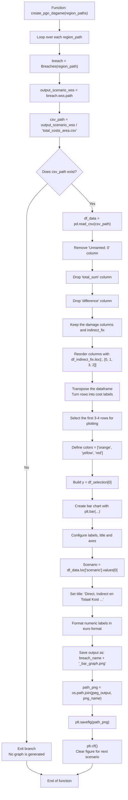

# create_pgn_dagame flowchart



## What this function actually does

This function does not calculate damage itself. Its job is to take the CSV generated by the previous step, reshape it into a plotting-friendly table, and export a bar chart per scenario.

The function reads the file:

- total_costs_area.csv

Then it:

1. loads the CSV from the scenario WSS folder,
2. removes metadata columns and summary rows,
3. reorders the values for plotting,
4. builds a bar chart with direct, indirect, and total cost values,
5. saves the result as a PNG in the scenario JPEG folder.

## Input data source

The function expects this CSV to already exist in the scenario output folder:

```text
<scenario_folder>/02_WSS/total_costs_area.csv
```

The data structure created by the previous step includes values such as:

- scenario
- direct
- indirect
- total_damage_raster
- total_sum
- difference
- indirect_fix

## Output produced by this function

```text
<scenario_folder>/04_JPEG/<scenario_name>_bar_graph.png
```

## Code path

Relevant implementation in the current file:

- [hhnk_threedi_tools/breaches/rasters/breach_wdepth_damage.py](../rasters/breach_wdepth_damage.py)

## Important implementation detail

The code contains a small quirk:

```python
    df_indirect_fix = df_indirect_fix.iloc[:, [0, 1, 3, 2]]
    df_indirect_fix.rename(columns={"indirect_fix": "indirect"})
```

The rename is not assigned back to the dataframe, so the plotted column remains based on the current dataframe values rather than the renamed label. In practice, this function is a presentation/export step, not a core calculation step.
