# Clip models flowchart

```mermaid
flowchart LR
    A["1. Inputs\nFunction: create_clip_models.run\nmodel folder, subareas, field name, grid cells, config"] --> B["2. Validation and file discovery\nFunction: Submodels.__init__\n_check_file_exists, _check_field_existence_and_uniqueness"]

    B --> C{"Overlapping polygons or duplicate names?\nFunction: _check_field_existence_and_uniqueness"}
    C -- No --> D["3. Select schematisation mapping\nFunction: submodel_constants + _read_geopackage_layers"]
    C -- Yes --> E["Overlap/ambiguity case\nThe code does not resolve overlaps explicitly\nIt only validates uniqueness of polygon names"]

    D --> F{"schematisation_type?\nFunction: SchematisationType"}
    F -- RANA --> G["RANA path\nLayer names/IDs from LAYER_NAMES_RANA and COLUMNS_RANA"]
    F -- THREEDI --> H["3Di path\nLayer names/IDs from LAYER_NAMES_THREEDI and COLUMNS_THREEDI"]

    G --> I["4. Iterate each polygon\nFunction: Submodels.run\nfor each sub-area in self.subareas"]
    H --> I
    E --> I

    I --> J["5. Prepare output model\nFunction: Submodels._clip\ncreate output directory and copy GPkg (and SQLite for 3Di)"]
    J --> K["6. Filter model elements inside the polygon\nFunction: _spatial_join + filtering on connection nodes, channels, pipes, culverts, 1D/2D layers"]

    K --> L{"isolate_1d == True?\nFunction: Submodels._clip"}
    L -- Yes --> M["7A. Keep full 1D network and isolate out-of-area elements\nFunction: isolate_1d_elements / set_isolated_1d\nRANA uses exchange_type; 3Di uses calculation_type"]
    L -- No --> N["7B. Keep only in-area connected elements\nFunction: _write_layer"]
    M --> N

    N --> O{"Calculation-grid cells intersect the sub-area?\nFunction: Submodels._clip"}
    O -- No --> P["Stop with exception\nNoCalcGridCellsSelectedError"]
    O -- Yes --> Q["8. Clip rasters to the dissolved grid mask\nFunction: _clip_raster\nGDAL Warp with cutline + cropToCutline"]

    Q --> R["9. Export submodel files\nFunction: Submodels.run returns list[Path]\nGeoPackage + rasters folder created in the polygon directory"]
    R --> S["10. Clean boundary features\nFunction: submodels_clean.run\nclean_submodel_boundary / remove_selection"]

    S --> T{"isolate_1d == True?\nFunction: submodels_clean.run"}
    T -- Yes --> U["Final cleanup branch\nFunction: isolate_1d_elements\nSet isolated flag for channels, pipes, culverts, optional manholes"]
    T -- No --> V["Final cleaned submodel\nGeoPackage ready for use"]
    U --> V

    E -. unresolved overlap note .-> V
    P -. optional note .-> V
```

## Stage-to-file mapping

| Stage | File | Primary function | What it does |
|---|---|---|---|
| Inputs and orchestration | [hhnk_threedi_tools/breaches/clip_models/create_clip_models.py](../hhnk_threedi_tools/breaches/clip_models/create_clip_models.py) | `run` | Receives the schematisation directory, polygon file, field name, calculation-grid file, and options like `isolate_1d` and `schematisation_type`; calls the clipping and cleaning passes. |
| Validation and setup | [hhnk_threedi_tools/breaches/clip_models/submodels.py](../hhnk_threedi_tools/breaches/clip_models/submodels.py) | `Submodels.__init__` | Validates the schematisation folder, checks required files, reads the sub-area polygons and calculation-grid layer, and aligns CRS when needed. |
| Exception handling | [hhnk_threedi_tools/breaches/clip_models/exceptions.py](../hhnk_threedi_tools/breaches/clip_models/exceptions.py) | custom exception classes | Raises explicit errors for missing files, empty layers, missing field names, duplicate names, and no intersecting calculation cells. |
| Mapping by schematisation type | [hhnk_threedi_tools/breaches/clip_models/submodel_constants.py](../hhnk_threedi_tools/breaches/clip_models/submodel_constants.py) | `SchematisationType`, `LAYER_NAMES`, `COLUMNS_NAMES` | Stores the actual layer and column names for `RANA` vs `THREEDI`, so the same logic can read the correct schema. |
| Model iteration | [hhnk_threedi_tools/breaches/clip_models/submodels.py](../hhnk_threedi_tools/breaches/clip_models/submodels.py) | `Submodels.run` | Loops over each polygon and creates one submodel per item in the sub-area dataset. |
| Prepare output model | [hhnk_threedi_tools/breaches/clip_models/submodels.py](../hhnk_threedi_tools/breaches/clip_models/submodels.py) | `Submodels._clip` | Creates the target directory, copies the source GeoPackage, copies the SQLite file for 3Di, and loads all model layers. |
| Feature filtering | [hhnk_threedi_tools/breaches/clip_models/submodels.py](../hhnk_threedi_tools/breaches/clip_models/submodels.py) | `_spatial_join`, `_write_layer` | Selects features whose geometry falls inside or is connected to the sub-area and writes the filtered set back to the copied GeoPackage. |
| Optional 1D isolation | [hhnk_threedi_tools/breaches/clip_models/submodels_clean.py](../hhnk_threedi_tools/breaches/clip_models/submodels_clean.py) | `isolate_1d_elements`, `set_isolated_1d` | If enabled, keeps the 1D network but marks elements outside the sub-area as isolated using the correct field (`exchange_type` for RANA, `calculation_type` for 3Di). |
| Raster masking | [hhnk_threedi_tools/breaches/clip_models/submodels.py](../hhnk_threedi_tools/breaches/clip_models/submodels.py) | `_clip_raster` | Dissolves the intersecting calculation-grid cells into a single mask and runs GDAL Warp to clip every raster file to that mask. |
| Boundary cleanup | [hhnk_threedi_tools/breaches/clip_models/submodels_clean.py](../hhnk_threedi_tools/breaches/clip_models/submodels_clean.py) | `run`, `clean_submodel_boundary`, `remove_selection` | Removes features near the submodel boundary that are not part of the final clipped model, then optionally isolates 1D elements. |

### Uncertainty / interpretation notes

- The actual export is not a separate “report”; the main product is the copied GeoPackage for each polygon, plus an optional `rasters/` folder containing clipped TIFF files.
- The logic for boundary cleanup is specific and code-driven: it removes a defined set of channels, exchange lines, boundary conditions, orifices, connection nodes, and cross sections based on spatial intersections. This is not a generic “all features outside polygon” rule, so the diagram reflects the actual filtering logic rather than a simplified description.
- The `RANA` vs `THREEDI` distinction is real in this codebase: layer names and the ID fields differ, and 1D isolation uses different fields (`exchange_type` vs `calculation_type`).
- The code validates that polygon names are unique, but it does not explicitly check for overlapping geometry. If the polygons overlap, the current workflow does not resolve that ambiguity in a dedicated branch; it simply continues with the per-polygon clipping logic.
- The `README.md` in this folder describes the intended workflow, and the implementation in the Python code is the source of truth for the diagram.

## References consulted

- [hhnk_threedi_tools/breaches/clip_models/README.md](../hhnk_threedi_tools/breaches/clip_models/README.md)
- [hhnk_threedi_tools/breaches/clip_models/create_clip_models.py](../hhnk_threedi_tools/breaches/clip_models/create_clip_models.py)
- [hhnk_threedi_tools/breaches/clip_models/submodels.py](../hhnk_threedi_tools/breaches/clip_models/submodels.py)
- [hhnk_threedi_tools/breaches/clip_models/submodels_clean.py](../hhnk_threedi_tools/breaches/clip_models/submodels_clean.py)
- [hhnk_threedi_tools/breaches/clip_models/submodel_constants.py](../hhnk_threedi_tools/breaches/clip_models/submodel_constants.py)
- [hhnk_threedi_tools/breaches/clip_models/exceptions.py](../hhnk_threedi_tools/breaches/clip_models/exceptions.py)
- [pixi.toml](../pixi.toml)
