# create_pgn_dagame flowchart

```mermaid
flowchart TD
    A["create_pgn_dagame(region_paths)"] --> B["for cada region_path"]
    B --> C["breach = Breaches(region_path)"]
    C --> D["output_scenario_wss = breach.wss.path"]
    D --> E["jpeg_output = breach.jpeg.path"]
    E --> F["csv_path = output_scenario_wss / 'total_costs_area.csv'"]
    F --> G["flujo principal: asumir CSV ya existe y es válido"]

    G --> H["1) calculate_depth_raster(...)\nCrea: grid_raw.gpkg, mask_flood.gpkg, max_wdepth_orig.tif, max_waterlevel_orig.tif"]
    H --> I["2) calculate_damage_raster(...)\nCrea: damage_orig_lizard.tif, direct_cost_damage.tif, indirect_cost_damage.tif"]
    I --> J["3) save_damage_csv(...)\nGuarda: total_costs_area.csv"]
    J --> K["4) create_pgn_dagame(...)\nLee el CSV y genera la imagen final"]

    K --> L["df_data = pd.read_csv(csv_path)"]
    L --> M["df_no_unamaed = df_data.drop(['Unnamed: 0'], axis=1)"]
    M --> N["df_no_total = df_no_unamaed.drop(['total_sum'], axis=1)"]
    N --> O["df_no_diference = df_no_total.drop(['difference'], axis=1)"]
    O --> P["df_indirect_fix = df_no_diference.drop(['indirect'], axis=1)"]
    P --> Q["Reordenar columnas para plotting\ndf_indirect_fix.iloc[:, [0, 1, 3, 2]]"]
    Q --> R["Transponer DataFrame\nprepara valores para barras"]
    R --> S["df_selection = df_data[1:4]"]
    S --> T["Colores = ['orange', 'yellow', 'red']"]
    T --> U["y = df_selection[0]"]
    U --> V["plt.bar(x=df_selection.index, height=y, color=color)"]
    V --> W["Añadir título, ejes y etiquetas en €"]
    W --> X["path_png = os.path.join(jpeg_output, png_name)"]
    X --> Y["plt.savefig(path_png)"]
    Y --> Z["Fin del ciclo por escenario"]
```



## Secuencia real del proceso

La lógica funcional del script es esta secuencia de 4 etapas:

1. Cálculo del raster de profundidad y waterlevel
   - `calculate_depth_raster(...)`
   - produce `grid_raw.gpkg`, `mask_flood.gpkg`, `max_wdepth_orig.tif`, `max_waterlevel_orig.tif`

2. Cálculo del damage raster
   - `calculate_damage_raster(...)`
   - produce `damage_orig_lizard.tif`, `direct_cost_damage.tif`, `indirect_cost_damage.tif`

3. Guardado del CSV de daño
   - `save_damage_csv(...)`
   - genera `total_costs_area.csv` en la carpeta `02_WSS`

4. Generación de la imagen final
   - `create_pgn_dagame(...)`
   - lee ese CSV, reordena los valores y guarda un gráfico tipo barras en `04_JPEG`

## Rama ignorada en este diagrama

La rama:

```python
if csv_path.exists():
    ...
else:
    ...
```

se omite como flujo principal porque es solo una validación de entrada. Para la presentación técnica, el proceso relevante es la secuencia de 4 funciones ejecutadas en orden, no la decisión de si el CSV ya existía.

## Salida final

```text
<scenario_folder>/04_JPEG/<scenario_name>_bar_graph.png
```

## Resumen ejecutivo

```text
NetCDF -> grid_raw.gpkg -> max_wdepth_orig.tif -> damage rasters -> total_costs_area.csv -> bar chart PNG
```
