# Download breach result flowchart

```mermaid
flowchart LR
    A["1. Inputs\nFunction: download_breach_scenario\nbase_folder, simulation_metadata_df"] --> B["2. Authenticate to 3Di API\nFunction: download_breach_scenario\nread API key, create ThreediApi client, set dl.set_api_key"]

    B --> C["3. Build scenario list\nFunction: simulation_metadata_df['scenario_name']\n+ simulation_metadata_df['scenario_id']"]
    C --> D["4. Iterate scenarios\nFunction: for x_name in filter_names"]

    D --> E{"Scenario exists in API and simulation id matches metadata?\nFunction: api_client.usage_list(simulation__name=x_name)"}
    E -- No --> F["Skip scenario\nNot present in active simulations"]
    E -- Yes --> G["5. Resolve model and output folder\nFunction: model_name = metadata_df.loc[...]\nPath(base_folder, model_name, x_name)"]

    G --> H["6. Create breach folder structure\nFunction: Breaches(breach_folder)\n01_NetCDF / 02_WSS / 03_SSM / 04_JPEG + CSV files in root"]

    H --> I["7. Prepare result paths\nFunction: breach_folder.netcdf.path, breach_folder.ssm.path, breach_folder.jpeg.path\nresultnc, resulth5, aggregate_results_3di.nc"]
    I --> J{"aggregate_results_3di.nc already exists?\nFunction: if not os.path.exists(aggregated_result)"}

    J -- Yes --> K["Reuse existing results\nFunction: usage_list(simulation__name=x_name).results[0]"]
    J -- No --> L["Download new results\nFunction: download_results_from_3di(netcdf_path, x_name, api_client)"]

    K --> M["8. Open result datasets\nFunction: GridH5ResultAdmin(resulth5, resultnc)\nGridH5AggregateResultAdmin(resulth5, aggregated_result)"]
    L --> M

    M --> N["9. Detect active breach in the model\nFunction: gr.lines.breach_width[-1, :] > 0\nfind breach_line and breach_id"]
    N --> O["10. Compute breach metrics\nFunction: breach_width, breach_depth, breach_q, breach_u, upstream/downstream water level\n+ aggregated versions"]

    O --> P["11. Build time series DataFrames\nFunction: pd.DataFrame(...)\nfor full and aggregated series"]
    P --> Q["12. Save result files to breach folder\nFunction: df.to_csv(...), df_agg.to_csv(...), simulation_data.csv"]

    Q --> R{"PNG graph already exists?\nFunction: os.path.exists(fig_path_name_agg)"}
    R -- Yes --> S["Skip graph creation\nresults already stored"]
    R -- No --> T["Optional graph export\nFunction: create_breach_graph(...)\ncurrently commented out in the script"]

    T --> S
    F -. no matching scenario .-> V["End of scenario loop"]
    S --> V
```



## Breach folder structure used by the code

```text
<base_folder>/<model_name>/<scenario_name>/
├── 01_NetCDF/
│   ├── aggregate_results_3di.nc
│   ├── gridadmin.h5
│   ├── results_3di.nc
│   └── read_me.txt
├── 02_WSS/
│   └── read_me.txt
├── 03_SSM/
│   └── read_me.txt
├── 04_JPEG/
│   └── read_me.txt
├── breach_data.csv
├── breach_data_agg.csv
├── simulation_data.csv
└── ... optional PNG files if generated later
```

This structure is defined in `Breaches` and implemented by `NetCDF`, `WSS`, `SSM`, and `JPEG` in [hhnk_threedi_tools/breaches/breaches.py](../breaches.py).

## Stage-to-file mapping

| Stage | File | Primary function | What it does |
|---|---|---|---|
| Entry point | [hhnk_threedi_tools/breaches/start_download_simulation/download_primair_kering_breach_results.py](../start_download_simulation/download_primair_kering_breach_results.py) | `download_breach_scenario` | Downloads and saves the outputs for one breach scenario using the 3Di API and local folder structure. |
| API authentication | [hhnk_threedi_tools/breaches/start_download_simulation/download_primair_kering_breach_results.py](../start_download_simulation/download_primair_kering_breach_results.py) | `download_breach_scenario` | Reads the local 3Di API token and creates the `ThreediApi` client. |
| Scenario lookup | [hhnk_threedi_tools/breaches/start_download_simulation/download_primair_kering_breach_results.py](../start_download_simulation/download_primair_kering_breach_results.py) | `usage_list(simulation__name=x_name)` | Resolves the API simulation ID for each scenario name specified in the metadata table. |
| Output folder creation | [hhnk_threedi_tools/breaches/breaches.py](../breaches.py) | `Breaches`, `NetCDF`, `WSS`, `SSM`, `JPEG` | Creates the scenario folder layout: `01_NetCDF`, `02_WSS`, `03_SSM`, `04_JPEG`, and CSV outputs at the root. |
| Download result files | [hhnk_threedi_tools/breaches/start_download_simulation/download_results_from_3di.py](../start_download_simulation/download_results_from_3di.py) | `download_results_from_3di` | Downloads missing NetCDF/HDF result files from the 3Di API into the scenario’s NetCDF folder. |
| Result analysis | [hhnk_threedi_tools/breaches/start_download_simulation/download_primair_kering_breach_results.py](../start_download_simulation/download_primair_kering_breach_results.py) | `GridH5ResultAdmin`, `GridH5AggregateResultAdmin` | Opens the raw and aggregated result datasets to read breach time series. |
| Metric extraction | [hhnk_threedi_tools/breaches/start_download_simulation/download_primair_kering_breach_results.py](../start_download_simulation/download_primair_kering_breach_results.py) | breach metric calculations | Computes breach width, depth, discharge, velocity, and upstream/downstream water levels for the active breach. |
| CSV persistence | [hhnk_threedi_tools/breaches/start_download_simulation/download_primair_kering_breach_results.py](../start_download_simulation/download_primair_kering_breach_results.py) | `df.to_csv`, `df_agg.to_csv` | Saves the full and aggregated breach data plus the summary file `simulation_data.csv`. |
| Optional figure export | [hhnk_threedi_tools/breaches/maps_graphs/create_breach_graph.py](../maps_graphs/create_breach_graph.py) | `create_breach_graph` | Intended to generate PNG graphs, but it is currently commented out in this script. |

### Notes from the actual code

- The script treats each scenario as a separate folder under the model folder, using the `Breaches` helper to ensure the expected directory structure is created.
- The key output folder is not just a flat dump: the code explicitly creates `01_NetCDF`, `02_WSS`, `03_SSM`, and `04_JPEG`, plus several CSV files in the scenario root.
- A result is only downloaded if the aggregated output file is missing; otherwise the script reuses the existing result set.
- The metric extraction is focused on the currently active breach (`breach_width > 0` at the final time step) and computes summary values from the raw and aggregated time series.
- The script currently skips graph generation because the graph creation calls are commented out; the actual persistent outputs are the CSV files and the NetCDF/HDF result files in the standard breach folder structure.
