# Start breach simulation flowchart

```mermaid
flowchart LR
    A["1. Inputs\nFunction: start_simulation_breaches\nmodel_folder, organisation_name, scenarios, filter_id, metadata_path, wait_time"] --> B["2. API authentication\nFunction: start_simulation_breaches\nread_api_file + ThreediApi(config=...)\nlogin via auth_profile_list"]

    B --> C["3. Organisation selection\nFunction: organisations_list(name__istartswith=...)\nresolve organisation UUID"]
    C --> D["4. Find target model\nFunction: threedimodels_list(name__contains=model_folder.name)\nselect model by schematisation_name and model name"]

    D --> E["5. List potential breaches\nFunction: threedimodels_potentialbreaches_list\nget breach candidates from the 3Di model"]
    E --> F["6. Match breach IDs to scenario list\nFunction: fiona.open(model_folder.schema.path, layer='potential_breach')\ncompare display_name / scenario number"]

    F --> G{"filter_id provided?\nFunction: start_simulation_breaches"}
    G -- No --> H["Use all breach IDs selected from the metadata layer"]
    G -- Yes --> I["Use the explicit filter_id list"]
    H --> J["7. Resolve selected breach records\nFunction: connected_pnt_id matching\ncollect breach_selected_idxs from API results"]
    I --> J

    J --> K["8. Loop over selected breaches\nFunction: for x in breach_selected_idxs"]
    K --> L["9. Resolve breach metadata and scenario name\nFunction: fiona.open(..., layer='potential_breach')\nbuild scenario_name from breach code"]

    L --> M{"scenario name format valid?\nFunction: start_simulation_breaches"}
    M -- Yes --> N["10. Create simulation from template\nFunction: simulation_templates_list + simulations_from_template\nname, tags, threedimodel, organisation, start_datetime, duration"]
    M -- No --> O["Raise ValueError\nscenario name pattern not accepted"]

    N --> P["11. Apply simulation settings\nFunction: simulations_settings_time_step_*\nsimulations_settings_numerical_*\nsimulations_settings_physical_*\nsimulations_settings_aggregation_create"]
    P --> Q["12. Create breach event\nFunction: simulations_events_breaches_create\nset breach duration, depth and width"]
    Q --> R{"Queue available?\nFunction: statuses_list(name__startswith='queued')"}

    R -- No --> S["Queue simulation\nFunction: simulations_actions_create(..., data={'name': 'queue'})\nlog scenario id"]
    R -- Yes --> T["Wait for wait_time seconds and retry queue check"]
    T --> R

    S --> U["13. End loop\nContinue with next breach scenario"]
    U --> V["Process complete"]
    O -. error path .-> V
``` 

## Stage-to-file mapping

| Stage | File | Primary function | What it does |
|---|---|---|---|
| Entry point | [hhnk_threedi_tools/breaches/start_download_simulation/start_primair_kering_breach_simulation.py](../start_download_simulation/start_primair_kering_breach_simulation.py) | `start_simulation_breaches` | Main workflow for starting multiple breach simulations from a model and a selected set of potential breaches. |
| API authentication | [hhnk_threedi_tools/breaches/start_download_simulation/start_primair_kering_breach_simulation.py](../start_download_simulation/start_primair_kering_breach_simulation.py) | `start_simulation_breaches` | Reads the 3Di API token from the local QGIS plugin config and creates the API client. |
| Organisation lookup | [hhnk_threedi_tools/breaches/start_download_simulation/start_primair_kering_breach_simulation.py](../start_download_simulation/start_primair_kering_breach_simulation.py) | `api_client.organisations_list` | Resolves the target organisation UUID used to create or place simulations. |
| Model lookup | [hhnk_threedi_tools/breaches/start_download_simulation/start_primair_kering_breach_simulation.py](../start_download_simulation/start_primair_kering_breach_simulation.py) | `api_client.threedimodels_list` | Finds the 3Di model matching the local model folder name. |
| Potential breach retrieval | [hhnk_threedi_tools/breaches/start_download_simulation/start_primair_kering_breach_simulation.py](../start_download_simulation/start_primair_kering_breach_simulation.py) | `api_client.threedimodels_potentialbreaches_list` | Pulls the list of available potential breaches from the API. |
| Scenario-to-breach mapping | [hhnk_threedi_tools/breaches/start_download_simulation/start_primair_kering_breach_simulation.py](../start_download_simulation/start_primair_kering_breach_simulation.py) | `fiona.open(..., layer='potential_breach')` | Reads the local GeoPackage layer and matches `display_name` / scenario number to the configured scenarios. |
| Breach filter selection | [hhnk_threedi_tools/breaches/start_download_simulation/start_primair_kering_breach_simulation.py](../start_download_simulation/start_primair_kering_breach_simulation.py) | `if not filter_id` / `id_filter = filter_id` | Decides whether to use all selected breaches or only the explicitly provided IDs. |
| Simulation creation | [hhnk_threedi_tools/breaches/start_download_simulation/start_primair_kering_breach_simulation.py](../start_download_simulation/start_primair_kering_breach_simulation.py) | `simulation_templates_list`, `simulations_from_template` | Creates the simulation instance from the template using the model ID, org UUID and time settings. |
| Simulation settings | [hhnk_threedi_tools/breaches/start_download_simulation/start_primair_kering_breach_simulation.py](../start_download_simulation/start_primair_kering_breach_simulation.py) | `simulations_settings_*_create` / `*_delete` | Applies numerical, physical, time-step and aggregation settings. |
| Breach event setup | [hhnk_threedi_tools/breaches/start_download_simulation/start_primair_kering_breach_simulation.py](../start_download_simulation/start_primair_kering_breach_simulation.py) | `simulations_events_breaches_create` | Defines the breach event with duration, max depth and opening geometry parameters. |
| Queue management | [hhnk_threedi_tools/breaches/start_download_simulation/start_primair_kering_breach_simulation.py](../start_download_simulation/start_primair_kering_breach_simulation.py) | `statuses_list`, `simulations_actions_create` | Ensures the API queue is not overloaded before starting each simulation. |

### Notes from the actual code

- This workflow is a simulation launcher, not a local model processing step. It authenticates to the 3Di API and then creates model runs for selected breach scenarios.
- The function reads the in-model `potential_breach` layer in the GeoPackage to map display names to scenario numbers. The matching logic is done by comparing the final segment of `display_name` with the requested scenario values.
- The code contains a hard-coded `scenario_name` formatting rule based on the breach code; if the code does not match the expected pattern, it raises a `ValueError`.
- The metadata update block is commented out in the script (`metadata_gdf` writes to shapefile), so the current live function focuses on simulation creation and queueing rather than persisting metadata back to disk.
- The queue decision is explicit: it refuses to start a new simulation when the number of queued items is already above the threshold, and waits `wait_time` before retrying.
