# Upload overstromingsmodellen flowchart

```mermaid
flowchart LR
    A["1. Inputs\nFunction: SchematisationUploader.__init__\nsqlite_path, commit_message, organisation_name"] --> B["2. API authentication\nFunction: _get_api_client\nread API key from local profile and connect to 3Di API"]

    B --> C["3. Select organisation\nFunction: organisations_list(name__istartswith=...)\nget org UUID from the matching organisation"]
    C --> D["4. Read schematisation metadata\nFunction: get_schematisation_metadata\nread admin/schematisation.json from model folder"]

    D --> E{"Metadata found and valid?\nFunction: get_schematisation_metadata"}
    E -- No --> F["Stop with runtime message\nThe JSON file is absent or not in the expected location"]
    E -- Yes --> G["5. Build uploader context\nFunction: SchematisationUploader.__init__\nstore schematisation_id, name, parent_revision, upload timeout"]

    G --> H["6. Identify rasters to upload\nFunction: upload_rasters\nscan local rasters/ folder and map DEM / friction / initial water level"]
    H --> I["7. Entry point for upload\nFunction: upload.upload_and_process\nfrom hhnk_threedi_tools.core.schematisation.upload"]

    I --> J{"Schematisation already exists?\nFunction: get_and_create_schematisation"}
    J -- Yes --> K["Reuse existing schematisation\nReturn existing object"]
    J -- No --> L["Create schematisation\nFunction: schematisations_create"]
    K --> M["8. Create empty revision\nFunction: schematisations_revisions_create\nempty=True"]
    L --> M

    M --> N["9. Upload SQLite model\nFunction: upload_sqlite\nzip the GeoPackage and upload it to the revision"]
    N --> O{"Raster upload loop\nFunction: upload_raster"}

    O --> O1["Raster exists and is already uploaded?\nFunction: upload_raster"]
    O1 -- Yes --> O2["Skip upload and continue"]
    O1 -- No --> O3["Create raster entry and upload via put_url"]
    O2 --> O4["10. Commit revision\nFunction: commit_revision\nwait until sqlite + rasters are uploaded, then commit"]
    O3 --> O4

    O4 --> P{"Revision becomes valid?\nFunction: create_threedimodel"}
    P -- No --> P1["Wait and retry for up to 10 cycles\nthen raise exception"]
    P -- Yes --> Q["11. Generate 3Di model\nFunction: create_threedimodel\ncreate model from revision, remove oldest if >2"]

    Q --> R["12. Return result\nFunction: upload_and_process\nreturns threedimodel id"]

    F -. note .-> R
    P1 -. note .-> R
```

## Stage-to-file mapping

| Stage | File | Primary function | What it does |
|---|---|---|---|
| API client setup | [hhnk_threedi_tools/breaches/upload_overstromingsmodellen.py](../hhnk_threedi_tools/breaches/upload_overstromingsmodellen.py) | `SchematisationUploader.__init__` | Creates the 3Di API client and resolves the target organisation, then reads the metadata needed to identify the schematisation. |
| Authentication | [hhnk_threedi_tools/breaches/upload_overstromingsmodellen.py](../hhnk_threedi_tools/breaches/upload_overstromingsmodellen.py) | `_get_api_client` | Reads the local API token from the QGIS profile and authenticates to the 3Di API. |
| Metadata discovery | [hhnk_threedi_tools/breaches/upload_overstromingsmodellen.py](../hhnk_threedi_tools/breaches/upload_overstromingsmodellen.py) | `get_schematisation_metadata` | Reads the model metadata from `admin/schematisation.json` in the parent directory of the local schematisation. |
| Raster selection | [hhnk_threedi_tools/breaches/upload_overstromingsmodellen.py](../hhnk_threedi_tools/breaches/upload_overstromingsmodellen.py) | `upload_rasters` | Scans the local `rasters/` folder and picks the files classified as DEM, friction and initial water level by filename. |
| Upload orchestration | [hhnk_threedi_tools/core/schematisation/upload.py](../hhnk_threedi_tools/core/schematisation/upload.py) | `upload_and_process` | Main orchestration: creates or reuses the schematisation, creates a revision, uploads the model database and rasters, commits the revision and creates a 3Di model. |
| Schematisation creation | [hhnk_threedi_tools/core/schematisation/upload.py](../hhnk_threedi_tools/core/schematisation/upload.py) | `get_and_create_schematisation` | Reuses an existing schematisation if found; otherwise creates a new one in the target organisation. |
| SQLite upload | [hhnk_threedi_tools/core/schematisation/upload.py](../hhnk_threedi_tools/core/schematisation/upload.py) | `upload_sqlite` | Packages the SQLite model as a ZIP and uploads it to the revision via the 3Di API. |
| Raster upload | [hhnk_threedi_tools/core/schematisation/upload.py](../hhnk_threedi_tools/core/schematisation/upload.py) | `upload_raster` | Creates the raster entry in the revision, checks whether it already exists, and uploads it if needed. |
| Revision commit | [hhnk_threedi_tools/core/schematisation/upload.py](../hhnk_threedi_tools/core/schematisation/upload.py) | `commit_revision` | Waits until the model and rasters are in the uploaded state, then commits the revision. |
| 3Di model creation | [hhnk_threedi_tools/core/schematisation/upload.py](../hhnk_threedi_tools/core/schematisation/upload.py) | `create_threedimodel` | Waits for the revision to become valid, cleans up old models if needed, and creates the 3Di model from the revision. |

### Notes from the actual code

- The real workflow is a 3Di API upload pipeline, not a local clipping or cleaning step.
- The script authenticates using a local API token from the QGIS plugin profile, then resolves the organisation UUID and model metadata.
- The raster loop is selective: only files whose names contain `dem`, `frictie`, or `ini` are uploaded, and the code passes them as a dictionary with keys such as `dem_file`, `frict_coef_file`, and `initial_waterlevel_file`.
- The API call sequence is: create/reuse schematisation -> create empty revision -> upload SQLite -> upload rasters -> commit revision -> create 3Di model.
- There is an explicit retention rule in `create_threedimodel`: if more than two 3Di models exist, the oldest one is deleted before creating a new model.
